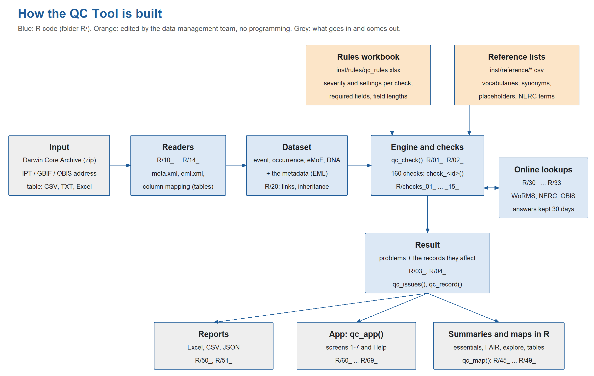

# QC Tool (Beta): manual

For the EMODnet Biology data management team, and for data providers who check their own data.

**Contents**

1. [What the tool does](#1-what-the-tool-does)
2. [Getting started](#2-getting-started)
3. [Everyday use](#3-everyday-use)
4. [The screens, one by one](#4-the-screens-one-by-one)
5. [Working in R (without the app)](#5-working-in-r-without-the-app)
6. [Reading the results](#6-reading-the-results)
7. [Maintenance](#7-maintenance) (rules, reference lists, [adding a check](#7-3-adding-a-check), online services, tests)
8. [Troubleshooting](#8-troubleshooting)
9. [Words used in this manual](#9-words-used-in-this-manual)

Appendix: the check catalogue (`inst/manual/checks.md`, made from the rules workbook).

---

## 1. What the tool does

The QC Tool checks a Darwin Core dataset before EMODnet Biology / EurOBIS harvests it. It reads:

- a **Darwin Core Archive** (the zip file an IPT makes),
- the **address of a dataset** on an IPT, GBIF or OBIS (it downloads the archive itself), or a link to an archive (.zip) or a table (.csv, .txt, .xlsx),
- a **simple table** (CSV, TXT or Excel) whose columns you match to Darwin Core terms.

It runs about 140 **checks**: files and columns, identifiers, required fields, vocabularies, dates, positions, depths, taxonomy, measurements (eMoF), duplicates, DNA data, metadata (EML), and outliers. Some checks ask online services: **WoRMS** (taxa), the **NERC Vocabulary Server** (measurement types and units) and **OBIS** (distance to the coast, depth of the sea floor).

There is **one set of rules**: the strictest of GBIF, OBIS and EMODnet Biology. Where GBIF or OBIS are less strict, the description of the check says so.

Every issue points to a **record**: its ID (eventID, occurrenceID, ...) and the line in the file. Identical problems are grouped ("this value in 3,000 records"), so even datasets with millions of records stay readable.

Each issue has a **severity**:

| Severity | Meaning |
|---|---|
| **error** | blocks the harvest: must be fixed |
| **warning** | for the data managers to judge |
| **info** | a hint or suggestion |

Which check has which severity is set in the **rules workbook** (`inst/rules/qc_rules.xlsx`), which the data management team can change without programming (section 7.1).

The **verdict** at the top of every report (app, Excel, R console):

| Verdict | When |
|---|---|
| *Not ready for harvest* | errors were found |
| *Not complete (checks did not run)* | no errors in the checks that ran, but checks that can block the harvest did not run, e.g. because WoRMS or OBIS did not answer or the check ran offline. The dataset is not cleared: check again online |
| *No errors* | only warnings |
| *No errors and no warnings* | nothing found |

Checks that did not run are always named right under the verdict, by area (e.g. *Taxonomy (WoRMS): 6, Location: 2*): their results are missing, also when the verdict is something else.

---

## 2. Getting started

### 2.1 Install (once, and again after each update)

You need R 4.2 or newer (tested with R 4.6). Installing the tool also installs every package it needs (data.table, shiny, leaflet, plotly, ...): there is no separate list to install by hand.

**From GitHub** (simplest):

```r
install.packages("remotes")
remotes::install_github("toastershock/qctool")
```

While the repository is private, GitHub asks for a token first: run `usethis::create_github_token()`, create the token on the page that opens, then `gitcreds::gitcreds_set()` and paste it.

**From a downloaded zip** (e.g. on the VLIZ RStudio Server): download the repository as zip (*Code > Download ZIP*), upload it, unzip it, open `qctool.Rproj` as a project, and run in the project:

```r
install.packages("remotes")
remotes::install_local(".", upgrade = "never")
```

`devtools::install()` and `renv::install()` in the project folder also install everything.

If a package fails to compile on a Linux server, the server lacks a system library; ask IT for `libcurl4-openssl-dev`, `libxml2-dev` and `libssl-dev` (curl, xml2, openxlsx2) and for GDAL, GEOS and PROJ (the map packages sf and terra, which leaflet needs).

### 2.2 Start the app

```r
library(qctool)
qc_app()        # opens the app in your browser (RStudio Server: in a new browser tab)
```

The app runs until you close its browser tab: then it stops by itself and R is free again (also when the connection is lost). Press *Stop* (Esc in the R console) to stop it from R. While the tab is open, the app keeps its connection alive, also when nobody clicks for a long time. Several people sharing one running app: `qc_app(stop_on_close = FALSE)`.

*For developers:* without installing, `devtools::load_all("qctool")` loads the tool from its folder (after a change to the code, run it again).

### 2.3 Your first check

1. On screen **1 Load**, choose *A file* and pick a dataset, e.g. `Datasets/dwca-biofun_2009-v1.9.zip`.
2. Press **Check the dataset**. A progress bar shows which check runs. Small datasets take seconds; FIFD (42 million records) about 5 minutes.
3. The app opens **2 Overview**: the verdict, the number of errors, warnings and info, and the essentials.
4. Go to **3 Data issues**, click a problem, then a record: you see the record as it is in the data, with the problem's column highlighted.
5. On **7 Download**, save the Excel report to send to the provider.

### 2.4 Without the app (in R)

```r
devtools::load_all("qctool")
result <- qc_check("Datasets/dwca-biofun_2009-v1.9.zip")
result                                   # summary in the console
qc_export_xlsx(result, "biofun_qc.xlsx") # the report
```

Section 5 explains all functions.

---

## 3. Everyday use

**Checking a dataset from an IPT.** Paste the address of the resource on screen 1 (*A web address*), e.g. `https://ipt.vliz.be/eurobis/resource?r=demerstock`. The tool finds the archive and downloads it (up to 2,000 MB; option `qctool.max_download_mb`). A link to a zip archive or to a table (.csv, .txt, .xlsx, e.g. on a provider's website) works too: what it is, the tool tells from the file itself. A table first shows its column mapping (see the next paragraph); press *Check the dataset* again after checking it. Only addresses starting with `http://` or `https://` are accepted; a file on your computer goes under *A file*.

**Checking a table from a provider.** Choose the CSV or Excel file. The app proposes a Darwin Core term for every column (*same name*, *a known other name*, *a similar name: please check*). Correct the proposals, set unused columns to *(not used)*, and choose whether each row is an occurrence or an event (sampling). Then check.

**What to tell the provider.** Errors must be fixed. Look at the warnings yourself and pass on those that matter. The Excel report (screen 7) has everything: the summary, the problems, and every issue with record ID and line, which the provider can find in their own file.

**When there is no internet.** Untick *Use online services* (or work offline anyway). Checks that need WoRMS, NERC or OBIS then use the answers stored during earlier checks (30 days). If an answer is missing, the check is *not performed*: never an error in the data, but never a pass either. The verdict then says *Not complete* when such a check could block the harvest, the checks that did not run are listed right under the verdict, and an essential whose checks did not run is grey (*not fully checked*). The position-on-land check then uses a coarse coastline and says "approximate".

**Only some checks.** On screen 1, under *Only some checks*, choose groups (e.g. *Metadata (EML)*) or single checks. Checks they depend on are added automatically.

**Making a check more or less strict.** Whether a check gives an error, a warning or info is set in the rules workbook `QC Tool/qctool/inst/rules/qc_rules.xlsx`, column *severity* of the sheet *Checks*. Change it in Excel, save, and check again: the app reads the workbook at every check. Section 7.1 explains it step by step.

---

## 4. The screens, one by one

### 1 Load

| Part | What it does |
|---|---|
| A file | DwC-A zip, or a table: .csv, .txt, .tsv, .xlsx, .xls (up to 3,000 MB) |
| A web address | IPT resource page, GBIF or OBIS dataset page, or a link to an archive (.zip) or a table (.csv, .txt, .tsv, .xlsx, .xls). Only `http://` and `https://` addresses. A table shows its column mapping after the first press on *Check the dataset*; press again to check |
| Sheet (Excel) | which sheet of the workbook is the table |
| Which Darwin Core term is each column? | the column mapping for tables, with example values and how the proposal was found. A column name that is used twice keeps its term only once; look-alikes of geology terms ('Group', 'Member', 'Bed') are not proposed |
| Each row of the table is | an occurrence, or an event (a sample) |
| Use online services | WoRMS, NERC, OBIS on or off; the line below says whether there is an internet connection |
| Own rules workbook | check with a changed copy of the rules workbook (e.g. to try a stricter setting) |
| Only some checks | groups or single checks; empty = all. With an own rules workbook, the groups and checks of that workbook count |
| Check the dataset | starts the check; afterwards the app opens the Overview |

### 2 Overview

- **The verdict** (section 1) with the dataset title, file name, date of the check and how long it took.
- **Checks that did not run**, right under the verdict, with the reason (e.g. WoRMS did not answer, or the check ran offline). Their results are missing from the report: nothing is known about them, also not that they passed.
- **Errors, warnings, info, records**: the totals and the records per table.
- **Essentials**: every EurOBIS record needs a taxon, a position, a date and an occurrenceStatus. Per essential the share of occurrences *without errors* in its fields, also when the value comes from the event above the occurrence. Green: all fine; orange: at least 90 %; red: less; grey: not fully checked, because some of its checks did not run (they are named). Warnings are mentioned but do not lower the share.
- **Links between tables**: whether every occurrence, measurement and DNA record points to an event or occurrence that exists, every parentEventID to an existing event, and every eventID and occurrenceID is unique. Green: *All links are intact*. Otherwise a red list: which problem, in which table, how many records. These are the most common real errors (section 6, *Links between tables*).
- **Values and their IDs**: whether every value goes with one ID and every ID with one value: scientificName and scientificNameID, measurementType and measurementTypeID, unit and unitID, value and valueID, institutionCode and institutionID, and so on. Green: *Every value goes with one ID*. Otherwise one row per value with more than one ID (or ID with more than one value), naming all of them with their records, e.g. *metres: use one measurementUnitID: 123A (40 records) or 123B (3 records)*, and how many records to change (section 6, *Values and their IDs*).
- **Data checks per table**: one card per table (event, occurrence, eMoF, DNA) with what is wrong, in enough detail to fix it in your own file: the problem, the field, what exactly is wrong, example values next to their correction (e.g. `'21/05/2020' → 2020-05-21`), and the number of records. Problems about whole columns are combined (e.g. *Required column missing: eventDate, decimalLatitude, ...*). No record IDs here: those are on screen 3. Tick *errors*, *warnings*, *info* to choose what is listed (errors first: they block the harvest).
- **Metadata (EML)**: one line; details on screen 4. For a simple table: a note that a table has no metadata.
- **About this check**: how many checks had which status, the online lookups (how many answers came from the stored answers), notes from reading the data, the rules workbook used, the version.

### 3 Data issues

One tab per table; the screen opens on the first table with errors. In each tab:

1. **Problems**: one row per identical problem (same check, field, value and message), with the value, what is wrong and the suggestion side by side, and the number of records. A filter box above each column; *severity*, *problem* and *field* have drop-down lists. The sidebar chooses severities (errors first) and checks; the line above the table says how many problems of other severities are not shown.
2. Click a problem: **Records with this problem**: up to 10,000 records, each as it is in the data: record ID, line in the file, the link to the core (column *id*, or *id (core link)* in an extension: the event or occurrence the record belongs to), the problem's column(s) first and highlighted, then all other columns. (All records of a problem: CSV download.) A problem "about the whole column, file or table" has no records: e.g. a missing column.
3. Click a record: **everything about it**, in four tabs:
   - *Issues*: all issues of this record, and those of the events above it (column *where*).
   - *Values*: all its filled fields.
   - *Events above it*: the parent events, nearest first (level 1 = its own event).
   - *Measurements*: its eMoF rows.

### 4 Metadata

- **FAIR**: the metadata checks per letter (Findable, Accessible, Interoperable, Reusable), e.g. *7 / 9 checks passed*. A quick indication, not a certification. Interoperable also counts the standard terms and vocabularies in the data. Which check counts for which letter: `inst/reference/fair_checks.csv`.
- **Metadata issues**: all issues of the EML, with where they are (e.g. `eml.xml: dataset/contact`) and suggestions. Also the licence when it is a column of the data (`license`), because the licence belongs to the metadata; those issues are not repeated on screen 3.
- **What the metadata says**: title, abstract, licence, citation, contacts, creators, metadata providers, keywords, time span, area, taxa, methods, DOI. "(missing)" shows what is not there.

A simple table has no metadata; the screen says so.

### 5 Map

- **Coloured points**: records with a problem about their position or depth (on land, swapped coordinates, far outside the sampling area, deeper than the sea floor, ...). Errors red, warnings orange, info blue. At most 20,000 points (errors first); the note says how many there are in all. Hover over a point for the check and the record ID; click it for the message and the value too.
- **Grey points**: all other positions (a sample of 20,000 when there are more).
- **Area given in the metadata**: the bounding box(es) of the EML, dashed.
- **Tracks**: tick *Tracks* and choose *One track per*: the top-level event (cruise), parentEventID, organismID, the first part of the eventID (often the cruise, station or tag), recordedBy, datasetName, ..., or one track. The positions are joined in date order; a dot marks the start. Useful to see jumps in cruise tracks or animal tracks.

A point on land can be right (estuaries, rivers, lagoons): the map is there for a person to judge.

### 6 Explore

A look at the data. Nothing here is a check or changes the verdict.

The charts are interactive: **hover** over a bar or point to read its values (in Relationships also the record ID), **drag** to zoom in, **double-click** to zoom out, and click a name in the legend to hide or show that part. The camera icon saves the chart as a picture.

| Tab | What you see |
|---|---|
| Tables | the data itself. Which tables there are, core or extension, how many records, and how they are linked (e.g. *24,125 of 24,125 occurrences are linked to an event*; for the eMoF: how many measurements belong to an occurrence, to an event only, or to nothing). Below: the rows of a table: all of them up to 100,000 rows (option `qctool.max_table_rows`), so the boxes above the columns filter the whole table; of a bigger table the first 100, and then the boxes only filter those 100. *Find* searches the **whole** table: a column *is* a value, *contains* a text (capitals ignored), *is empty*, or a line number of the file (up to 1,000 rows shown). Then the columns of the table: how often each is filled, with examples. |
| Time | records per year (or per month for short spans); shaded: the time span in the metadata; dashed: where the middle 95 % of the records lie; records without a valid date and records outside the metadata time span |
| Taxa | the 20 taxa with most records (orange: a taxonomy check found something) and all taxa with rank, status, accepted name and habitat from WoRMS (from the stored lookups) |
| Measurements | per measurement type and unit: records, how many are numbers, minimum / median / maximum, examples of text values, the NERC label of the type, the issues |
| Distributions | a histogram or a box plot of any number: latitude, longitude, depths, year, counts, every measurement per unit; for all taxa or one; optionally on a log scale. The box plot shows one box for all records and one per taxon (the 15 with most values): the box holds the middle 50 %, the line is the median, the whiskers reach up to 1.5 box lengths, and the orange dots are the values beyond (handy to spot a 900 cm fish) |
| Relationships | two measurements of the same records (e.g. length and weight) with a crude model: *power* y = a x^b (length-weight), *exponential* or *linear*. Orange: records more than *n* typical deviations from the curve. The table lists them with their record ID. Choose one taxon at a time for meaningful results. |
| Sexes | females, males and other values per taxon (from the field `sex`, or a sex/gender measurement) |
| Events | the event hierarchy per level (cruise > station > sample ...): how many events, with occurrences, with measurements, with their own date and position |

### 7 Download

| File | For | Notes |
|---|---|---|
| Excel report | reading and sharing | sheets Summary (verdict, essentials, FAIR, ...), Checks, Issues grouped, Issues, About the checks. At most 100,000 rows per issue sheet (you can raise it to 1,048,575, Excel's limit); the Summary says when rows were left out |
| CSV files (zip) | further work in R, Python, a database | every issue, also millions; comma or semicolon (semicolon opens directly in Excel with Belgian, Dutch or German settings); compressed (.csv.gz) above Excel's limit |
| JSON | other programs | run information, checks, problems, and every issue when they fit |

### Help menu

- **Checks**: find a check by words (e.g. *NERC label*, *land*, *ORCID*): all words must appear in its title, description, fields or notes. Click a check for everything about it: what, why, severity, where GBIF/OBIS differ, tables, fields, settings, the checks it runs after, its reference list, the online service it uses, its result in the dataset you checked, and where its code is.
- **Manual**: this text.
- **About the tool**: version, disclaimer, contact, useful links (OBIS manual, obistools, Ocean Teacher Global Academy, EMODnet Biology, EurOBIS, WoRMS, NERC, Darwin Core, IPT manual). Edit them in `inst/reference/about_the_tool.csv`.

If something goes wrong on a screen, that screen shows a red box with the message; the other screens keep working. Please send the message and the dataset to whoever maintains the tool.

---

## 5. Working in R (without the app)

Everything the app shows comes from these functions.

### Checking

```r
result <- qc_check(input,           # zip, folder, IPT/GBIF/OBIS address, link to a zip or table, or a table
                   checks = NULL,   # e.g. c("eventdate_iso8601", "points_on_land"); all
                   rules = NULL,    # path to an own rules workbook
                   progress = FALSE,           # TRUE: a progress bar in the console
                   mapping = NULL,  # tables, e.g. c(Datum = "eventDate", Notes = NA)
                   sheet = NULL,    # Excel: the sheet
                   table_type = "occurrence",  # tables: "occurrence", "event" or "emof"
                   online = TRUE)   # FALSE: stored answers only
```

`qc_suggest_mapping(c("Date", "Latitude", "species"))` shows which term each column of a table would get.

### Results

| Function | Gives |
|---|---|
| `result` (print) | the verdict, statuses, checks that did not run, checks with issues |
| `result$checks` | one row per check: status, issues, records affected, reason, duration |
| `result$issues_grouped` | one row per identical problem, with example records |
| `qc_issues(result, check =, severity =, problem =, limit =)` | every issue with record ID, file, line (and `table_row`) |
| `qc_record(result, "occurrence", 12)` | one record: values, issues (also of its events), events above it, measurements |
| `qc_essentials(result)` | the essentials table |
| `qc_links(result)` | the links between tables: broken links per check and table |
| `qc_one_to_one(result)` | values and their IDs: one row per value with several IDs (or ID with several values), all of them with their records |
| `qc_fair(result)` | FAIR per letter, and per check |
| `qc_map_points(result)` | positions with problems, and the others (as tables) |

### A map without the app

```r
qc_map(result)                       # interactive map in the RStudio Viewer (or the browser)
qc_map(result, "map.html")           # the same, saved as a web page to open or send
qc_map(result, "map.png")            # a picture (also .pdf): coastline, no internet needed
qc_map(result, severity = "error")   # errors only
# one check, without the grey positions
qc_map(result, checks = "points_on_land", others = FALSE)
```

The positions with an issue about latitude, longitude or depth are coloured (errors red, warnings orange, info blue), the others grey, the area of the metadata dashed. In the interactive map, hover over a point for the check and the record ID, click for the details. The web page needs the folder `map_files` that is saved next to it.

### Saving

```r
qc_export_xlsx(result, "report.xlsx", max_issue_rows = 100000)
qc_export_csv(result, "report_folder", sep = ";")
qc_export_json(result, "report.json")
```

### Exploring

`qc_time_summary()`, `qc_taxa_summary()`, `qc_emof_summary()`, `qc_event_levels()`, `qc_numeric_variables()`, `qc_variable_values()`, `qc_relationship(result, x, y, model = "power")`, `qc_sex_ratio()`, `qc_tracks(result, by = "organismID")`.

The tables themselves (as on Explore > Tables):

```r
qc_tables(result)                        # the tables and how they are linked
qc_table_columns(result, "occurrence")   # how often each column is filled, with examples
qc_find_rows(result, "occurrence", "occurrenceID", "O-123", how = "is")$rows
qc_find_rows(result, "occurrence", "scientificName", "abra", how = "contains")$rows
qc_find_rows(result, "event", how = "line", value = "250")$rows    # line 250 of the file
qc_box_stats(qc_variable_values(result, "emof:1"))   # box plot numbers, per taxon
```

### Checks and rules

```r
qc_checks("NERC label")   # find checks by words
qc_read_rules()           # what the tool reads from the rules workbook
qc_clear_cache()          # forget the stored WoRMS / NERC / OBIS answers
```

### Many datasets at once

`dev/run_test_datasets.R` checks every dataset in `../Datasets` and writes the reports to `../output/<dataset>/` plus `overview.csv`. Copy it to check your own list of datasets.

### Options

Settings of the tool itself (not of the checks: those are in the rules workbook). All of them are in one file, `R/08_options.R`, with what they do. Change one with `options()` before `qc_check()` or `qc_app()`, e.g. `options(qctool.max_unzipped_mb = 1500)`, in the R console, in `.Rprofile` or in a server's start script.

| Option | Default | Meaning |
|---|---|---|
| `qctool.online` | TRUE | default for `online =` |
| `qctool.cache_dir` | `tools::R_user_dir("qctool", "cache")` | where answers of WoRMS, NERC and OBIS are stored |
| `qctool.cache_days` | 30 | after how many days an answer is asked again |
| `qctool.timeout` | 60 | seconds per internet request |
| `qctool.max_download_mb` | 2000 | largest dataset downloaded from a web address (MB) |
| `qctool.max_unzipped_mb` | Inf (no limit) | largest archive after unzipping (MB). A server open to everyone should set one: a small zip can unpack to many GB |
| `qctool.max_upload_mb` | 3000 | largest file uploaded in the app (MB); also `qc_app(max_upload_mb = )` |
| `qctool.block_private_addresses` | FALSE | TRUE: refuse web addresses on the server's own network (localhost, 10.x, 192.168.x, ...). For a public server |
| `qctool.max_table_rows` | 100000 | Explore > Tables: a table up to this many rows is shown whole, so the filters above its columns search all rows; a bigger one shows its first 100 rows |

---

## 6. Reading the results

### Statuses of a check

| Status | Meaning |
|---|---|
| issues found | the check ran and found problems |
| passed | the check ran and found nothing |
| not applicable | the data has nothing to check (e.g. no eMoF table, no depth column) |
| not performed | it needed something that was not there, usually a service that did not answer or no internet; run again later |
| skipped | a check it depends on could not run (e.g. *scientificname_matches_aphiaid* needs *scientificnameid_exists_in_worms*) |
| check error | the check itself failed: a bug or unexpected data. The others continue. Please report it. |
| not yet implemented | in the rules workbook, not built yet |
| switched off | severity *off* in the rules workbook |

*Not performed*, *skipped* and *check error* mean the check **did not run**: its results are missing, so it neither found nor cleared anything. These checks are listed right under the verdict; when one of them could block the harvest (severity *error*), the verdict is *Not complete* (section 1).

### Where an issue is reported

- **Is it there?** Missing values are judged on the value an occurrence ends up with, also when it comes from the event above it. A missing date is reported on the event that should have it, not again on each of its occurrences. When the value cannot come from an event because the link is broken, the message says so (*the occurrence is not linked to an existing event*, *its parent event does not exist*): fix the link first.
- **Is it right?** A wrong value is reported where it is written: a wrong date on an event is an issue of that event, even if 100 occurrences take it over.
- Measurements (eMoF) rarely have their own ID: they are pointed to by the occurrenceID (or eventID) plus the measurement type.

### Links between tables

In a Darwin Core Archive every extension record (occurrence, measurement, DNA) belongs to one record of the core through the archive's **id column**: in an event core the eventID of its event, in an occurrence core the occurrenceID of its occurrence. The tool shows it as the column *id (core link)*. Events are linked to their parent through **parentEventID**. Many extension files also have their own eventID or occurrenceID column; it must say the same as the id column. Values inherit along these links (date and position from the event, and from the events above it), so a broken link also makes values go missing.

| What is wrong (example) | Reported by | Where |
|---|---|---|
| An occurrence, measurement or DNA record points to an event (or occurrence) that does not exist, or has an empty id | *Record points to an event or occurrence that does not exist* (`extension_links_to_core`) | the table of that record |
| An occurrence's or measurement's eventID names a missing event, or another event than its id column | *eventID names another or a missing event* (`extension_eventid_matches_coreid`) | idem |
| Occurrence core: an eMoF or DNA occurrenceID names a missing occurrence, or another one than its id column | *occurrenceID names another or a missing occurrence* (`extension_occurrenceid_matches_coreid`) | idem |
| Event core: an eMoF occurrenceID that is not in the Occurrence table | *eMoF occurrenceID not in the Occurrence table* (`emof_occurrenceid_exists`) | eMoF |
| Event core: a DNA occurrenceID that is not in the Occurrence table | *DNA record's occurrenceID not in the Occurrence table* (`dna_occurrenceid_exists`) | DNA |
| A measurement of an occurrence is linked to another event than that occurrence | *eMoF event differs from the occurrence's event* (`emof_event_matches_occurrence`) | eMoF |
| A parentEventID that is no eventID (without an eventID column: no id of the event core) | *parentEventID points to a missing event* (`parenteventid_exists`) | Event |
| Events whose parents go round in a circle | *Loop in the event hierarchy* (`event_hierarchy_no_loops`) | Event |
| An eventID or occurrenceID used twice: links to it are ambiguous | *eventID used more than once*, *occurrenceID used more than once* | Event, Occurrence |
| A measurement linked to nothing: no id, no occurrenceID, no eventID | *eMoF record not linked* (`emof_record_linked`) | eMoF |

All of them are errors, and all of them are listed together on the Overview under **Links between tables** (in R: `qc_links(result)`). When you open a record with a broken link (screen 3), a red line above its details says what is broken, e.g. *This occurrence points to event 'E8', which does not exist in the event table.*

### Values and their IDs

Many values come with an ID that says the same in a fixed form: the scientificName with its scientificNameID, the measurementType with its measurementTypeID, and so on. In the whole dataset they must go **one-to-one**: one value, one ID, and one ID, one value. The tool counts every combination. Each value with more than one ID is **one problem**, which names all its IDs with their number of records, the most used first: value *metres*, suggestion *use one measurementUnitID: 123A (40 records) or 123B (3 records)*. Its records are those with a less common ID (here the 3 with 123B), the ones to change. The same for an ID with more than one value. Empty values are left out.

| What is wrong (example) | Reported by | Severity |
|---|---|---|
| *Acantephyra eximia* with `...taxname:564909` in 19 records and with `...taxname:` (cut off) in one | *scientificName and scientificNameID do not go one-to-one* (`scientificname_id_one_to_one`) | error |
| One scientificNameID with *Pandalus borealis* and with *Pandalus borealis Kroyer, 1838* | idem | warning |
| A name without scientificNameID while other records of that name have one (or the other way round) | idem, the ID (or name) of the other records as suggestion | warning |
| *length* with two different measurementTypeIDs, or one measurementTypeID with *sampling net mesh size* and *sampling net outer cover* | *measurementType and measurementTypeID do not go one-to-one* (`measurementtype_id_one_to_one`) | error / warning |
| *mm* with two unit IDs, or P06 XXXX with *Not applicable* and *not applicable* | *measurementUnit and measurementUnitID do not go one-to-one* (`measurementunit_id_one_to_one`) | error / warning |
| Within a type: *adult* with two valueIDs, *adult* and *Adult* with one valueID, or one valueID on many different numbers (a NERC term put in measurementValueID instead of measurementTypeID) | *Value and value ID do not go one-to-one* (`measurementvalueid_consistent`) | warning |
| institutionCode and institutionID, collectionCode and collectionID, datasetName and datasetID, recordedBy and recordedByID, identifiedBy and identifiedByID, country and countryCode, higherGeography and higherGeographyID | *Other values and their IDs do not go one-to-one* (`values_and_ids_one_to_one`) | warning |
| Only one way (an ID has one value; a value may have several IDs): taxonID and scientificName (in DNA data the taxonID is often the ASV), organismID and scientificName, locationID and locality, and in an occurrence core eventID and eventDate, decimalLatitude, decimalLongitude | idem | warning |

One value with several IDs is the worse case: one of the IDs is wrong, so some records end up under another taxon or parameter. One ID with several values is usually spelling, and is reported as a warning. The pairs of the last check are in `reference/one_to_one_pairs.csv` (section 7.2): add a row for another pair. All of them are listed together on the Overview under **Values and their IDs** (in R: `qc_one_to_one(result)`).

### Counting

*Issues* counts each problem per record (a record with two problems counts twice). *Records affected* counts each record once per check. A problem about a whole column or the metadata counts as one issue.

### Dates

EMODnet accepts ISO 8601 dates, also with a space instead of the "T" before the time (`2013-08-12 19:47:00`). Shortened intervals like `2011-07/09` are valid ISO 8601 but the EurOBIS harvester cannot read them: they are reported as errors, with the full form as suggestion. An interval whose end is only a time (`2019-05-21T10:00/12:00`) is a warning (suggestion: `2019-05-21T10:00/2019-05-21T12:00`).

The date a record was last changed, `modified` (dcterms:modified), is reported as info when it is missing or empty (`modified_filled`).

### How checks are named

A check is named after the problem it looks for: *scientificName does not match the AphiaID*, *Required column missing*. In the lists of issues the name then says what is wrong, without having to turn it around. On Help > Checks and in the FAIR details the same names mean "what the check looks for"; the status (*passed*, *issues found*) says whether it was found. The names are in the `title` column of the rules workbook and can be changed there.

### A few decisions

- **IDs**: an occurrenceID only has to be unique within the dataset; running numbers (1, 2, 3) are fine. The check *occurrenceID may not be unique outside this dataset* is switched off.
- **Licence**: CC0, CC-BY and CC-BY-NC are accepted, as a web address or as a short name: *CC-BY*, *cc by 4.0*, *CC0*, and also a plain *CC* (read as CC-BY). Licences with SA (share-alike) or ND (no derivatives) are not accepted.
- **Encoding**: a file saved in another encoding than UTF-8 (often Windows-1252 from Excel, e.g. `±`, `é`) is read as Windows-1252, so that all checks can run on it, and *Broken characters (text not valid UTF-8)* lists every such value as it was read; save the file as UTF-8 to fix it. A note under *About this check* says how many values it concerned. (Archives whose meta.xml says ISO-8859-1 are read as that.)

---

## 7. Maintenance

### 7.0 How the tool is built



A dataset goes from left to right: the **readers** turn an archive, an address or a table into one **dataset** (its tables and its metadata); the **engine** runs the **checks** on it; every check reports what it finds; the **result** collects the problems with the records they affect; the reports, the app and the R functions show the result. What a check accepts (severity, numbers, required fields, length limits) comes from the **rules workbook**; lists of words and codes come from the **reference lists**. Both are edited without programming.

**Find a check, and the numbers it uses**

1. **Find it**: in the app *Help > Checks*, search with a few words (e.g. *length institutionCode*, *land*, *ORCID*), or in R `qc_checks("length")`. Click it: the details show its id, its settings, where its values come from (*reference list*) and its code (*Code*: file and function).
2. **Its numbers**: in the rules workbook. A check's own numbers are in the sheet **Checks**, column **settings** (e.g. `buffer_m = 3000` for *Position on land*). Limits per field are in the sheets **Fields** (required / recommended) and **Field lengths** (the longest value per term).
3. **Its lists** (words, codes, synonyms) are the CSV files of section 7.2.
4. **Its code**: the file in the folder `R/` named under *Code*, function `check_<check_id>()`. Every check starts with a short comment: what, why, settings.

The appendix *Where each check lives* lists all of this for every check in one table.

*Example: the length of institutionCode.* Help > Checks, search *length*: the check is *Value too long for the EurOBIS database* (`field_length_within_eurobis_limit`), code in `R/checks_01_structure.R`, values from the sheet *Field lengths*. In that sheet, the row *institutionCode* has `max_length` 50: the size of that column in the EurOBIS database. Change it there; longer values are errors, and values longer than `warning_above` (where filled) are warnings.

### 7.1 The rules workbook: severities, settings, required fields

How strict the tool is, is not in the code but in one Excel file, the **rules workbook**:

**`QC Tool/qctool/inst/rules/qc_rules.xlsx`**

(on the team laptop: `C:\Users\<you>\Documents\GitHub\QC Tool\qctool\inst\rules\qc_rules.xlsx`). The app shows where the workbook in use is: Help > About the tool, where you can also download it.

The tool reads this file **at every check**: the app and `qc_check()` alike. A change counts from the next time you press *Check the dataset*; the app does not need a restart. (Help > Checks reads the workbook when the page opens: reload the page, F5, to see a new severity there.)

**Change a check from error to warning (or the other way round)**

1. Find the check's id: in the app Help > Checks (search by words; the id is in the column *check_id*), or in R `qc_checks("words")`. Example: `eventdate_iso8601`.
2. Open `qc_rules.xlsx` in Excel, sheet **Checks**, and find the row with that id in column *check_id*.
3. Change the column **severity** to `error`, `warning`, `info` or `off` (off: the check does not run at all).
4. Save (keep the .xlsx format and the file name).
5. Check the dataset again: the issues of that check now have the new severity, and the verdict and the counts follow.

Example: with `eventdate_iso8601` set to warning, the badly written dates of a dataset count as warnings instead of errors, and the verdict and the counts change with them.

Every check's severity is in this column, so the DM team can make any check stricter or milder. A few checks give some of their issues a *lower* severity themselves, written in their description (e.g. *scientificName does not match the AphiaID*: up to 5 different letters is a warning; one-to-one checks: one ID with several values is a warning; *Unit does not fit the measurement type*: a unit of the same kind is info). The workbook can lower those too (set the check to warning or info), but not raise them above what the check gives.

**What else is in the workbook**

| Sheet | Column | Values |
|---|---|---|
| Checks | severity | error / warning / info / off |
| Checks | settings | every number or choice a check uses, e.g. `buffer_m = 3000; min_year = 1600` (separated by `;`). Change the value after `=`, never the name before it. Help > Checks and the appendix show the settings of each check |
| Checks | what, why, other_standards, notes | the texts people see (Help > Checks, the Excel report) |
| Checks | reference_list | where the check's values come from (a sheet of this workbook or a list in `reference/`) |
| Fields | requirement | required / recommended / optional: which Darwin Core fields must be present and filled |
| Fields | applies_to | all / dna-derived (only for DNA datasets) |
| Field lengths | max_length | the longest value per term; longer values are errors (the size of the column in the EurOBIS database, e.g. 50 for institutionCode) |
| Field lengths | warning_above | a lower limit that gives a warning (e.g. 350 for associatedOccurrences, the current harvester); empty: none |

- Do **not** change `check_id`: it links the row to the code.
- If the workbook contains something the tool does not understand (e.g. severity "eror"), `qc_check()` stops and names the sheet, row and column. `qc_read_rules()` shows what the tool reads.
- **Try a change without touching the real rules**: save a copy of the workbook under another name, change the copy, and choose it under *Own rules workbook* on screen 1 (in R: `qc_check(..., rules = "my_copy.xlsx")`). The real workbook stays as it is.
- **Installed copy.** An installed tool (`library(qctool)`) reads the workbook that was installed with it; Help > About the tool shows where that is (in R: `system.file("rules", "qc_rules.xlsx", package = "qctool")`). A change to the workbook in the project folder counts after installing again; a change to the installed copy counts at once but is lost at the next install. To keep own rules across updates, keep your own copy and choose it under *Own rules workbook* (in R: `qc_check(..., rules = "my_rules.xlsx")`). With `devtools::load_all("qctool")` the tool reads the files in the project folder.
- After changing texts or adding rows: `Rscript dev/write_check_catalogue.R` updates the check catalogue (the appendix).

### 7.2 Reference lists

Lists the checks use, as CSV files in `qctool/inst/reference/`. Edit them in a text editor or Excel (save as CSV, UTF-8). They are read at the next start of R. As for the rules workbook (7.1): an installed tool reads the lists that were installed with it, so a change in the project folder counts after installing again (or at once with `devtools::load_all("qctool")`).

| File | Used for |
|---|---|
| `dwc_terms.csv` | the EurOBIS term table: known terms, types, tables. (The length limits per term are in the rules workbook, sheet *Field lengths*.) |
| `vocabularies/*.csv` | accepted terms of basisOfRecord, occurrenceStatus, sex, lifeStage, taxonRank, dcType, countryCode, establishmentMeans, degreeOfEstablishment, pathway (column *also_written_as* for accepted variants) |
| `placeholders.csv` | texts that mean "empty" (NA, n/a, -, unknown, ...) |
| `term_synonyms.csv` | column names in tables and the term they stand for ("Latitude" -> decimalLatitude) |
| `name_patterns.csv` | what does not belong in scientificName (sp., cf., authorship, ...) |
| `inheritable_fields.csv` | fields an occurrence takes over from its event |
| `duplicate_fields.csv` | fields compared to find duplicate occurrences |
| `one_to_one_pairs.csv` | pairs of a value and its ID that must go one-to-one (institutionCode and institutionID, ...); *one way* = only one value per ID |
| `unit_synonyms.csv` | other ways to write a NERC unit ("individuals" for Dimensionless, "mg/g" for g/kg) |
| `nerc_quantity_terms.csv`, `sampling_effort_terms.csv`, `sampling_instrument_terms.csv`, `p01_to_dwc.csv`, `size_types.csv` | NERC codes for quantities, effort, instruments, types with their own DwC field, lengths and weights |
| `fair_checks.csv` | which check counts for which FAIR letter |
| `about_the_tool.csv` | the texts and links of Help > About the tool |

### 7.3 Adding a check

A check is one R function plus one row in the rules workbook, and a test. Start with the template:

```r
source("qctool/dev/new_check.R")
new_check("recordedby_filled", group = "other", table = "occurrence",
          field = "recordedBy", title = "recordedBy empty",
          what = "recordedBy (who observed or collected the record) is filled.",
          why = "Knowing who recorded an occurrence helps to judge it.")
```

It prints three pieces. Then:

1. **The row.** Add it to the sheet *Checks* of `qc_rules.xlsx`: check_id, group, title, severity, what, why (and settings, depends_on, tables, fields, lookup, reference_list when needed).
2. **The function.** Paste it into the printed file `R/checks_NN_<group>.R` (one file per group) and write the test: which values are a problem? A check gets `(dataset, settings)` and returns `new_issues(...)` (or `empty_issues()` when there is nothing). Copy a similar check: the files start with a list of their checks.
3. **The test.** Paste it into the printed file in `tests/testthat/`, with one record that passes and one that fails.
4. **Run** `devtools::load_all("qctool")` and `devtools::test("qctool")`. The tool refuses to start when a `check_...()` function has no row in the workbook, so the two cannot drift apart. A row without a function shows as *not yet implemented*.
5. **Try it** on all test datasets: `Rscript dev/stress_app_functions.R` (from the `qctool` folder) lists anything that fails.

The app needs nothing else: the new check appears on Help > Checks, in the Overview, in Data issues and in the reports.

**Building blocks** (see the existing checks):

| Function | Use |
|---|---|
| `require_fields(dataset, "event", c("eventDate"))` | the table, or "not applicable" when it or the column is missing |
| `rows_where(values, test)` | rows whose value fails the test; the test sees each *different* value once |
| `find_problem_values(values, describe)` | like rows_where, with a different message per value |
| `new_issues(dataset, table, rows, field, value, message, suggestion, severity_hint)` | report; `severity_hint` can only *lower* the severity of single issues |
| `inherited_value(dataset, "occurrence", "eventDate")` | the value of a field per record, including what comes from parent events |
| `setting(settings, "min_year", 1600)` | a setting from the rules workbook, with a default |
| `reference_table("placeholders.csv")` | a reference list |
| `skip_check("reason")`, `not_performed("reason")` | statuses *not applicable* and *not performed* |
| `worms_records()`, `nerc_terms()`, `xy_lookup()` | online lookups with cache and offline mode (R/31-33) |

**Three things that go wrong** (each happened while building the tool):

1. **The name rule.** Only check functions may start with `check_`. A helper called `check_something` makes the tool stop with "These checks exist in the code but have no row in the rules workbook". Call helpers e.g. `titles_of_checks`.
2. **data.table names.** Inside `data[...]` a name means the *column* first. `problems[severity %in% severity]` compares the column with itself and keeps everything. Give variables names that are not column names (`wanted_severity`), or compute the selection outside the brackets.
3. **Speed.** Never run `trimws()`, `tolower()` or `grepl()` over a whole column: on 34 million eMoF values that takes minutes. Use `rows_where()`, `per_value()`, `lower_trim()`, `as_number()`; group by numbers (`value_codes()`), not by text. Check speed on FIFD (`dev/run_test_datasets.R --all`).

**A check that needs the internet:** use the lookups in `R/31_lookup_worms.R`, `R/32_lookup_nerc.R`, `R/33_lookup_xy.R`; never call a web service directly. They ask each different value once, store the answers, work offline from the stored answers, and turn a service that does not answer into *not performed*. Put the service in the *lookup* column of the workbook. Tests replay recorded answers (7.5).

### 7.4 Online services and stored answers

- Answers of WoRMS, NERC and OBIS are stored per service in `tools::R_user_dir("qctool", "cache")` (on Windows under `AppData/Local/R/cache/R/qctool`), with the date. After 30 days they are asked again.
- `qc_clear_cache()` (or one service: `qc_clear_cache("worms_records")`) forgets them, e.g. after a WoRMS update you need now.
- A service that does not answer is tried 3 times; the answers that came are kept; the check is *not performed* with the reason.
- If a service changes its answers (a new API), the parse functions in `R/31-33_lookup_*.R` need an update; the tests with recorded answers then still pass, so also try one real check online.

### 7.5 Tests

```r
devtools::test("qctool")      # all tests (about 3 minutes); no internet needed
```

- `tests/testthat/test-*.R`: one file per part; the checks per group, the readers, the engine, the exports, the lookups, the summaries, the app (with `shiny::testServer`).
- Online checks are tested with **recorded answers** (`tests/testthat/fixtures/http_recorded.rds`). When a test of an online check changes, record again (online): `Sys.setenv(QCTOOL_RECORD = "1"); devtools::test("qctool", filter = "lookups")`, then `Sys.unsetenv("QCTOOL_RECORD")`.
- Tests never use the internet or your stored answers (`tests/testthat/setup.R`).
- `Rscript dev/stress_app_functions.R` runs every function the app uses on every test dataset and lists failures.
- `Rscript dev/run_test_datasets.R` (add `--all` for FIFD, `--offline` without internet) checks all test datasets and writes reports and `overview.csv` to `../output`.

Run the tests after every change and after updating R or packages.

### 7.6 Updating R and packages

After an update: `devtools::test("qctool")`, then `Rscript dev/stress_app_functions.R`, then open the app and check one dataset. If the app looks wrong after a bslib or shiny update, the screens are in `R/60-68_app_*.R`.

### 7.7 Big datasets

FIFD (43k events, 8.2 million occurrences, 33.8 million measurements): reading about 1 minute, all checks 4-5 minutes, peak memory 13 GB, Excel 5 s, CSV 1-2 minutes. The app keeps the result in memory while it is open. A server for the app needs 24 GB or more, or a size limit (`qc_app(max_upload_mb = )`).

### 7.8 Where things are

| File | What |
|---|---|
| `R/01_qc_check.R` | `qc_check()`: start reading here |
| `R/02_engine.R` | order of checks, statuses, what happens when a check fails |
| `R/03_issues.R`, `R/04_result.R` | how issues are stored and shown |
| `R/05_rules.R`, `R/09_check_catalogue.R` | the rules workbook; the check catalogue |
| `R/08_options.R` | the settings of the tool itself (internet, stored answers, size limits, server safety), with their defaults |
| `R/10-14_read_*.R` | reading archives, tables, EML, web addresses |
| `R/20_prepare.R` | links between tables, inherited values |
| `R/30-33_lookup_*.R` | WoRMS, NERC, OBIS, with cache and offline mode |
| `R/40_helpers.R` | dates, numbers, "each value once" |
| `R/45_summaries.R`, `R/46_explore.R`, `R/47_explore_more.R` | essentials, FAIR, record view, map points, explore |
| `R/48_map.R` | `qc_map()`: the map without the app (interactive, web page, picture) |
| `R/49_tables.R` | `qc_tables()`, `qc_table_columns()`, `qc_find_rows()`: the tables, their links, a search in the rows (Explore > Tables) |
| `R/50-51_export_*.R` | Excel, CSV, JSON |
| `R/60-69_app_*.R` | the app, one file per screen |
| `R/checks_NN_<group>.R` | the checks (which check is in which file: appendix, *Where each check lives*) |
| `inst/rules/qc_rules.xlsx` | the rules: severities, settings, required fields, field lengths |
| `inst/reference/` | the reference lists (and `check_code_files.csv`, written by the catalogue script) |
| `inst/manual/` | this manual, the check catalogue and the figure of section 7.0 |
| `docs/QC_Tool_manual.docx` | this manual as a Word document |
| `docs/design.md` | how the tool is built and why (the code refers to its sections) |
| `docs/storing_qc_requests.md` | for IT: how the checks people run could be stored (a request log), not built yet |
| `dev/` | scripts for the team: new check, test datasets, stress test, check catalogue, Word manual (`make_word_manual.R`), the figure (`make_architecture_figure.R`) |
| `tests/testthat/` | the tests |

### 7.9 After a change: the short list

1. `devtools::test("qctool")`: all pass.
2. `Rscript dev/stress_app_functions.R`: no failures.
3. Rules workbook or a check changed: `Rscript dev/write_check_catalogue.R` (updates the appendix of this manual).
4. The manual changed: `Rscript dev/make_word_manual.R` (the Word version), then open it once in Word to update the page numbers of the contents.
5. Raise the version in `qctool/DESCRIPTION` (e.g. 0.0.1 -> 0.0.2); it shows in the app and in every report.

---

## 8. Troubleshooting

| What you see | Why | What to do |
|---|---|---|
| `qc_app()`: "The app needs these packages" | a package is missing | install the packages it names |
| "These checks exist in the code but have no row in the rules workbook" | a function starts with `check_` but has no row | add the row (7.3), or rename the helper |
| The upload stops | the file is larger than 3,000 MB | `qc_app(max_upload_mb = 5000)` (or the option `qctool.max_upload_mb`) |
| Many checks *not performed* | no internet, or a service did not answer | check again later; or work offline on purpose |
| The verdict says *Not complete* | checks that can block the harvest did not run (listed under the verdict) | check again online; the dataset is not cleared until they ran |
| "This address leads to a table" | the web address gave a table, not an archive | check the column mapping that appeared, then press *Check the dataset* again |
| "The address gave a web page, not a dataset" | the link opens a page (e.g. a login or a download page), not the file | give the address of the file itself, or of the IPT resource |
| The first check of a DNA dataset takes minutes | thousands of names without scientificNameID are matched in WoRMS (slow) | wait once; the answers are stored for 30 days |
| A red box on a screen | that screen failed on this dataset | send the message and the dataset; the other screens work |
| Screens stay grey after a check | the browser lost track of the page | reload the page (F5) and check again |
| The Excel report misses issues | more than 100,000 issues | raise *Most issue rows in Excel*, or use the CSV download |
| Strange characters (é, or ± shown oddly) | the file is not UTF-8 | the check *Broken characters (text not valid UTF-8)* reports it, with a repaired suggestion; save the file as UTF-8 |
| The app goes grey: "The connection to R was lost" | the browser lost its connection to R (a server that closes quiet connections, a laptop that slept, or something that could not be sent to the browser) | the app has stopped and R is free: run `qc_app()` again and reload the page. If it happens with one particular file, please send that file to whoever maintains the tool |
| A column of a table is not used | no term was chosen for it | choose the term in the mapping on screen 1 |
| The box above a column cannot be used (grey) | in the rows of this table the column has only one value (or is empty), so there is nothing to filter | in Explore > Tables of a table over 100,000 rows only its first 100 rows are shown: search the whole table with *Find*, or raise the option `qctool.max_table_rows` |
| A value with two IDs: which IDs are they? | the records of such a problem are only those with a less common ID | its suggestion names all the IDs with their records; all such values at once: Overview, *Values and their IDs* |

---

## 9. Words used in this manual

| Word | Meaning |
|---|---|
| Darwin Core (DwC) | the standard for biodiversity data: terms like eventDate, scientificName |
| DwC-A, archive | a zip with data files, `meta.xml` (which file is what) and `eml.xml` (metadata) |
| core, extension | the main table (event or occurrence) and the tables linked to it (occurrence, eMoF, DNA) |
| event | a sampling event: a cruise, station, sample; events can have parent events |
| occurrence | a taxon found (or not found) at an event |
| eMoF | extended Measurement or Fact: measurements and facts about events and occurrences |
| EML | the metadata of a dataset: title, abstract, people, licence, coverage |
| IPT | the Integrated Publishing Toolkit that publishes archives |
| WoRMS, AphiaID, LSID | the World Register of Marine Species, its taxon number, and the ID form `urn:lsid:marinespecies.org:taxname:<AphiaID>` |
| NERC Vocabulary Server (NVS) | controlled terms: P01 measurement types, P06 units, L22 instruments, ... |
| inheritance | an occurrence takes a value (date, position) from its event when it has none itself |
| problem, issue | a problem is one kind of finding (same check, field, value, message); an issue is a problem in one record |
| severity | error, warning or info (section 1) |
| FAIR | Findable, Accessible, Interoperable, Reusable |
| stored answers, cache | answers of WoRMS, NERC and OBIS kept for 30 days |
